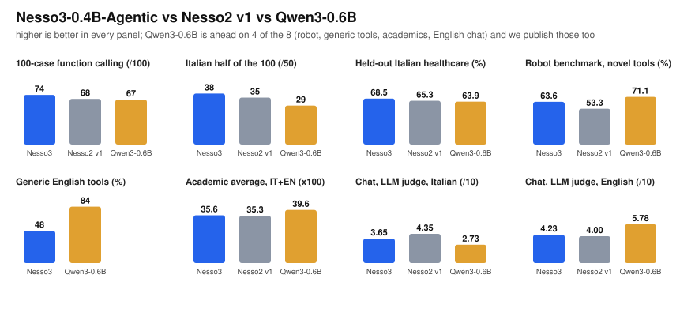
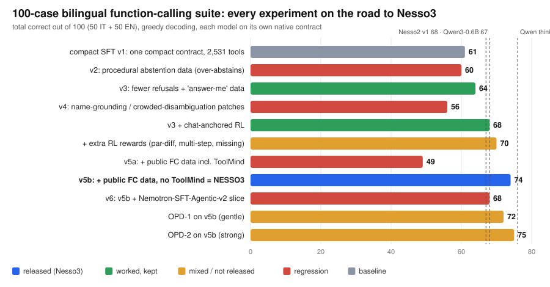

# Nesso3-0.4B-Agentic

**A ~0.4B bilingual (Italian/English) model for function calling and agentic execution. Among the models we measured (Qwen3-0.6B and our own earlier releases) it is the strongest for Italian tool use, and it is *not* a Qwen3-0.6B replacement for English-first or generic-tool use.** This page tells you how to run it, then shows the evidence: every benchmark, and every experiment that worked or failed on the way here.

- 🤗 Model: [`mii-llm/nesso3-0.4B-agentic`](https://huggingface.co/mii-llm/nesso3-0.4B-agentic) · model card: [`MODEL_CARD.md`](MODEL_CARD.md)
- 🧪 Raw result files for every number below: [`results/`](results/) · rebuild all tables with `python3 eval/summarize_results.py`
- 🧬 Lineage: [`zagreus-0.4B-ita`](https://huggingface.co/mii-llm/zagreus-0.4B-ita) → knowledge CPT → 32k context → agentic SFT. The first three phases are written up in the [Nesso2 report](../nesso2/README.md); this folder covers what changed afterwards.
- *Naming:* Nesso3 is the third generation of the family (Nesso → Nesso2 → Nesso3). The 3 is the generation, not the parameter count: the model has ~0.4B parameters.

---

## 1. How to use Nesso3

Install `transformers` and `torch`, then run the snippet below. Three things differ from most tool-calling models, and ignoring any of them degrades the output:

1. **Tools go inside the system message, not in `tools=`.** The model's Llama-3 template ignores the `tools=` argument of `apply_chat_template`; passing it silently drops your tools. Put them in the system text as compact JSON between `<tools>` tags.
2. **Decode greedily** (`do_sample=False`, no repetition penalty) for tool calls. A repetition penalty suppresses the structural JSON tokens.
3. **Tokenize with `add_special_tokens=True`** (the saved template does not emit BOS itself), so exactly one BOS is prepended.

```python
import re, json, torch
from transformers import AutoTokenizer, AutoModelForCausalLM

model_id = "mii-llm/nesso3-0.4B-agentic"
tokenizer = AutoTokenizer.from_pretrained(model_id)
model = AutoModelForCausalLM.from_pretrained(model_id, torch_dtype=torch.bfloat16, device_map="auto").eval()

CONTEXT = "Sei un assistente operativo. Usa gli strumenti disponibili quando serve."

def system_with_tools(context, tools):
    """The native contract: one short context sentence + compact <tools> block inside the system message."""
    return context + "\n<tools>\n" + json.dumps(tools, separators=(",", ":"), ensure_ascii=False) + "\n</tools>"

def chat(messages, max_new_tokens=256):
    prompt = tokenizer.apply_chat_template(messages, tokenize=False, add_generation_prompt=True)   # no tools= here
    inputs = tokenizer(prompt, return_tensors="pt", add_special_tokens=True).to(model.device)     # exactly one BOS
    n = inputs["input_ids"].shape[1]
    out = model.generate(**inputs, max_new_tokens=max_new_tokens, do_sample=False,                # pure greedy
                         eos_token_id=tokenizer.eos_token_id, pad_token_id=tokenizer.pad_token_id)
    text = tokenizer.decode(out[0][n:], skip_special_tokens=False)
    return re.split(r"<\|eot_id\|>|<\|end_of_text\|>", text)[0].strip()

def parse_calls(answer):
    return [json.loads(c) for c in re.findall(r"<tool_call>\s*(\{.*?\})\s*</tool_call>", answer, flags=re.S)]

tools = [
    {"type": "function", "function": {"name": "get_weather", "description": "Meteo attuale per una città",
        "parameters": {"type": "object", "properties": {"city": {"type": "string"}}, "required": ["city"]}}},
    {"type": "function", "function": {"name": "convert_currency", "description": "Converte un importo tra due valute",
        "parameters": {"type": "object",
            "properties": {"amount": {"type": "number"}, "from": {"type": "string"}, "to": {"type": "string"}},
            "required": ["amount", "from", "to"]}}},
    {"type": "function", "function": {"name": "search_restaurants", "description": "Cerca ristoranti in una città",
        "parameters": {"type": "object",
            "properties": {"city": {"type": "string"}, "cuisine": {"type": "string"}}, "required": ["city"]}}},
]
system = {"role": "system", "content": system_with_tools(CONTEXT, tools)}

# one call, right tool among several
print(parse_calls(chat([system, {"role": "user", "content": "Quanto sono 250 euro in sterline?"}])))
# [{'name': 'convert_currency', 'arguments': {'amount': 250, 'from': 'EUR', 'to': 'GBP'}}]

# parallel calls
print(parse_calls(chat([system, {"role": "user", "content": "Che tempo fa a Roma e a Torino?"}])))
# [{'name': 'get_weather', 'arguments': {'city': 'Roma'}}, {'name': 'get_weather', 'arguments': {'city': 'Torino'}}]

# no tool needed / no tool fits / missing argument: it answers or asks instead of inventing a call
print(chat([system, {"role": "user", "content": "Prenota un volo per Parigi."}]))
# Non posso prenotare un volo: nessuno degli strumenti disponibili lo consente.

# close the loop: run the tool yourself, return the raw JSON result as a `tool` turn
question = "Che tempo c'è a Roma adesso?"
ans = chat([system, {"role": "user", "content": question}])
observation = {"city": "Roma", "temp_c": 24, "condition": "soleggiato"}      # <- the result of YOUR get_weather()
print(chat([system, {"role": "user", "content": question}, {"role": "assistant", "content": ans},
            {"role": "tool", "content": json.dumps(observation, ensure_ascii=False)}]))
# Ci sono 24°C e la condizione è soleggiata.
```

*(The outputs in the comments are the ones we get by running exactly this code on the released weights.)*

**Know before you integrate** (details in [§6](#6-limitations-what-we-would-rather-you-hear-from-us)):

- Validate arguments in your application before executing any call. Treat unsupported values as missing.
- On short, fully-specified prompts the model sometimes **asks for an argument that is already there** (the "ask-reflex"). It is stronger when the prompt offers a single tool.
- After parallel calls, return **all results in one `tool` turn** (a JSON list). In one spot test, separate `tool` turns made it re-emit the calls with invented arguments.
- Keep the system context to one sentence and the tool list compact. The model is **format-locked**: ChatML, verbose OpenAI-style tool prompts or other layouts degrade it.
- For free-form Italian chat prefer [Nesso2-0.4B-Agentic](https://huggingface.co/mii-llm/nesso2-0.4B-agentic) or [nesso-0.4B-agentic](https://huggingface.co/mii-llm/nesso-0.4B-agentic) (§2).

The full model card (architecture, chat template, production notes, all benchmark tables) is in [`MODEL_CARD.md`](MODEL_CARD.md).

---

## 2. Results at a glance



| Benchmark | **Nesso3** | Nesso2 v1 | Qwen3-0.6B |
|---|---|---|---|
| Bilingual function calling, 100 cases (↑) | **74** | 68 | 67 non-thinking · 76 thinking |
| &nbsp;&nbsp;↳ Italian half (/50) | **38** | 35 | 29 non-thinking · 34 thinking |
| Held-out Italian healthcare-booking benchmark, 40 cases (%) | **68.5** | 65.3 | 63.9 |
| Production robot benchmark, novel tools, 84 cases (%) | 63.6 | 53.3 | **71.1** |
| Generic English tools, 33 scenarios (%) | 48 | n/a | **84** |
| Academic average, IT+EN (MMLU, ARC, HellaSwag, IFEval) | 0.3555 | 0.3531 | **0.3955** |
| Chat quality, LLM judge, Italian / English (/10, mean of 3 runs) | 3.65 / 4.23 | **4.35** / 4.00 | 2.73 / **5.78** |

**What this says.**

- Nesso3 is the best of our models on **Italian tool use**: +6 over Nesso2 on the 100-case suite, ahead of Qwen3-0.6B on the Italian half (38 vs 29, and vs 34 for Qwen in thinking mode), and ahead on the **unseen** Italian healthcare domain.
- Its gain over Nesso2 on novel tools (robot: 53.3 → 63.6) is what the release was built for: it learned **one tool contract** and generalises across thousands of tool schemas.
- It **loses clearly** to Qwen3-0.6B on generic English tools (48 vs 84), on robot function calling, on MMLU and IFEval (pre-training knowledge and instruction following that SFT does not close), and on English chat. It also chats worse in Italian than Nesso2 (3.65 vs 4.35): the price of training on one strict tool format.

**What was not measured** (so we make no claim): chat-anchored RL on top of Nesso3, and academics for the discarded v6 run (§4).

---

## 3. What Nesso3 is

Nesso2 learned a fixed toolbox in a verbose format and fell apart on tools it had not seen (robot benchmark 53.3). Nesso3 is built on a bet with two axes, and the experiments below are the evidence for and against it:

- **Memorise one contract.** At 0.4B the model locks into one prompt format. Tools are always `{ctx}\n<tools>\n[compact json]\n</tools>` inside the system message, calls are `<tool_call>{"name":..,"arguments":..}</tool_call>`, results are `tool` turns with raw JSON.
- **Generalise across many tools.** The synthetic function-calling corpus uses **2,531 procedurally generated tool schemas** (50/50 Italian/English), covering single, parallel, multi-argument, disambiguation, missing-argument questions, unavailable-tool refusals, no-tool answers, observation grounding and multi-step trajectories.

The released model is **SFT only** (no RL, no distillation):

| Component | Size | Role |
|---|---|---|
| Chat floor: omnia v6, all Italian + English score ≥ 0.6 | ~2.27M rows, ×1 | keeps it a usable conversationalist |
| Synthetic compact function-calling corpus | 36k rows, ×4 | skills above, over 2,531 tools |
| Public function-calling data, rendered into the compact contract | ~33k rows, ×1 | [xLAM-60k](https://huggingface.co/datasets/Salesforce/xlam-function-calling-60k) (CC-BY-4.0), [ToolACE](https://huggingface.co/datasets/Team-ACE/ToolACE) (Apache-2.0), [When2Call](https://huggingface.co/datasets/nvidia/When2Call) (CC-BY-4.0); about one third translated to Italian, reasoning traces removed, 8-gram decontaminated against our eval sets |

LR 1e-3, 3 epochs (5,094 steps), effective batch 128, max length 8,192, cosine to a 0.3 floor; final train / eval loss 1.307 / 1.26 ([`training/sbatch-sft-compact-v5b.sh`](training/sbatch-sft-compact-v5b.sh)). What made the difference versus the previous SFT recipe was **public data without ToolMind** (E7 below): +10 on the 100-case suite and +12 points on generic English tools.

---

## 4. The experiment log: what worked, what failed



One row per experiment, all graded from the raw outputs in [`results/`](results/). Each run was evaluated on the same battery; the benchmarks **disagree with each other**, which is why no single column picked the winner.

| # | Experiment | 100-case (IT/EN) | Robot (%) | Healthcare (%) | Generic tools (%) | Verdict |
|---|---|---|---|---|---|---|
| ref | Nesso2 v1 (verbose contract, fixed toolbox) | 68 (35/33) | 53.3 | 65.3 | – | previous release |
| E1 | compact SFT v1: one contract, 2,531 tools | 61 (30/31) | 62.9 | 71.3 | – | ✅ idea validated, holes open |
| E2 | v2: procedural abstention data | 60 (36/24) | 59.6 | 72.2 | – | ❌ over-abstains |
| E3 | v3: fewer refusals + "answer-me" no-tool data | 64 (36/28) | 63.5 | 69.7 | 36 | ✅ best of the first branch |
| E4 | v4: name-grounding / crowded-disambiguation patches | 56 (29/27) | 59.7 | 74.2 | – | ❌ trades one miscalibration for another |
| E5 | v3 + chat-anchored RL | 68 (37/31) | 61.8 | 70.2 | 45 | ✅ net win, judge up on every axis |
| E6 | E5 + extra RL rewards | 70 (36/34) | 61.4 | 71.3 | 42 | ◐ partial win |
| E7a | v5a: v3 recipe + public data **with** ToolMind | 49 (27/22) | **66.6** | 71.9 | 36 | ❌ collapses on the 100-case |
| **E7b** | **v5b: same, ToolMind removed = Nesso3** | **74 (38/36)** | 63.6 | 68.5 | **48** | ✅ **released** |
| E8 | v6: v5b + Nemotron-SFT-Agentic-v2 slice | 68 (35/33) | 61.1 | 61.6 | 45 | ❌ not released |
| E9 | OPD-1 on v5b (gentle) | 72 (38/34) | 63.3 | 72.7 | 51 | ◐ neutral, not released |
| E10 | OPD-2 on v5b (strong) | 75 (39/36) | 63.4 | 74.4 | 42 | ◐ real costs, not released |
| ref | Qwen3-0.6B (non-thinking / thinking) | 67 / 76 | 71.1 | 63.9 | 84 | |

### E1. One compact contract over 2,531 tools ✅ (the idea works)
**Hypothesis.** A 0.4B model cannot learn a general tool-use skill from a handful of tools; give it one rigid contract and thousands of schemas, and it should transfer to unseen tools.
**Result.** On the robot benchmark (tool schemas it never saw) the previous model collapsed (observation grounding 33%, no-tool 12%) where the compact model scored 79% and 52%; robot overall 53.3 → 62.9, and its robot conversation score (78.3) was also above the previous model's (76.9). **Costs:** 100-case 61 vs 68 (the old model's memorised canonical tools win that toy suite), parallel-different-tools at 0/10, and no abstention skill on novel tools (robot missing-argument 0%, unavailable-tool ~0).
**Format-lock, proven in both directions:** the old verbose template on this model, or the compact contract on the old model, both tank. It is part of why the model card is strict about the contract.

### E2. Procedural abstention data ❌ (over-correction)
**Hypothesis.** The abstention holes come from a generator that produced only 5 canned scenarios for "missing argument" and for "unavailable tool", so the model memorised phrasings instead of learning the skill.
**Change.** Both generators rewritten to be procedural and diverse (487 distinct missing-argument prompts, 693 unavailable-tool prompts, 32% hard domain-adjacent cases); negatives raised to ~37% of the mix.
**Result.** Targets moved: healthcare unavailable-tool 38 → 100, missing-argument 18 → 50, robot unavailable 17 → 57. But **no-tool answering collapsed** (healthcare 92 → 52, robot 52 → 17, 100-case 8 → 4) and observation grounding softened. Net: 100-case 61 → 60, robot 62.9 → 59.6.
**Lesson.** Diverse examples *teach* where canned ones were memorised, so the same ratio of negatives pulls much harder; the model generalised "no matching tool → refuse" onto answerable questions.

### E3. Fewer refusals plus "answer-me" data ✅
**Change.** Refusal share *below* the first version (missing 0.09, unavailable 0.06), plus 64 diverse "answer directly although tools are present" items (general knowledge, simple maths, advice, chit-chat), no-tool share 0.14 → 0.18.
**Result.** The unavailable-tool gain held (healthcare 38 → 88, robot 17 → 52), no-tool recovered (healthcare 92, 100-case 9), productive skills held or rose, robot conversation 83 / 81 (best of the branch). Best compact model at the time: 100-case 64, robot 63.5. One soft spot stayed: robot no-tool answering is 12% (that benchmark's no-tool cases ask to summarise or rewrite operational text, which the general-knowledge answer-me items do not cover).

### E4. Patches for an external benchmark's bugs ❌
**Trigger.** A third-party Italian benchmark (36 cases) reported our compact-v3 model at 55.6%. Re-running it on each model's *native* contract showed part of that was a harness artefact (a single generic prompt format that approximates Qwen's own; Qwen also *rose* from 88.9% to 94.4%), but also confirmed real bugs: inventing tool names, a search-tool confusion, an over-eager ask-reflex, and English-only enum values (`on/off`) in Italian training rows.
**Change.** Targeted data: creative-command no-tool rows, crowded-disambiguation rows, Italian-native binary-state tools (accesa/spenta, aperta/chiusa).
**Result.** The targeted bugs were fixed, healthcare rose to 74.2 and robot observation grounding to 76%, but the 100-case fell 64 → 56 and robot unavailable-tool 52 → 12: the "always commit to a real tool" pressure generalised into inventing calls for requests no tool covers.
**Scoring artefact found on the way.** The earlier model's perfect score on a negative-control case was partly accidental: it *did* try to invent a tool, but with malformed JSON the parser rejected. Found by reading raw outputs, not scores.
**Verdict.** Second time (after E2) that patching abstention/commit calibration with more SFT data traded one miscalibration for another. We stopped patching it with SFT.

### E5. Chat-anchored RL on v3 ✅ (kept, not combined into Nesso3)
GRPO with a branched reward: on tool prompts, reward **observation grounding** (do not re-call after a result); on chat prompts, reward **staying close to the model's own earlier answer** (token F1). Low KL coefficient (β 0.005), LR 1e-5, 800 steps, ~2h50m on a single GPU; KL stayed ≈ 0.001–0.002. Reproduces the recipe in [`../nesso2/training/`](../nesso2/training/).
**Result.** 100-case 64 → 68, robot observation grounding 51 → 64, judge better on every axis (both-language mean 4.32 → 4.68 over three runs). **Cost:** robot multi-step 70 → 52, because the reward cannot tell a spurious re-call from the legitimate second call of a real multi-step task.

### E6. Extra RL rewards (missing-argument, parallel-different, multi-step) ◐
Three more programmatically verifiable reward branches on top of E5.
**Result.** 100-case 70 and the **first non-zero parallel-different-tools score in the whole lineage** (0 → 2), robot multi-step recovered 52 → 62, **but** robot observation grounding gave back 64 → 54 (the two rewards pull the same context in opposite directions), robot missing-argument stayed at 0 (the policy never *sampled* an "ask" completion on those prompts, so there was no gradient), and the judge English score fell 0.4. A genuine partial win, not a Pareto improvement.

### E7. Public function-calling data ✅ (this is Nesso3) and ❌ (ToolMind)
**Why.** A stress test with seven plain English tools showed the model under-calling and inventing tool names (`multiply`, `sqrt`). We audited the public datasets before using any: zero Italian everywhere; heavy overlap (ToolMind's open part is derived from xLAM, ToolACE, When2Call and others; UltraData's tool rows are ToolMind); reasoning traces in 100% of ToolMind and UltraData rows; When2Call's SFT split has **no tool-call rows** at all (would re-create E2's over-abstention unless paired with call data); APIGen-MT is CC-BY-NC and was excluded.
**Build.** Everything rendered into the compact contract, reasoning removed, ~1/3 translated to Italian with Qwen3.6-35B-A3B (78% passed verification: values kept verbatim, language and length checks), 8-gram decontaminated against the 100-case, healthcare, robot, third-party and generic-tools sets (0 leaks). Two arms, same recipe otherwise: **v5a** with xLAM + ToolMind + ToolACE + When2Call (40,167 rows) and **v5b** without ToolMind (32,985 rows).

| 100-case category (/10) | v3 (base) | v5a (+ToolMind) | **v5b = Nesso3** | v6 (+Nemotron) |
|---|---|---|---|---|
| single | 5 | 2 | **7** | 4 |
| parallel, same tool | 8 | 4 | 8 | **9** |
| parallel, different tools | 1 | 1 | 3 | **4** |
| multi-argument | 6 | 3 | **8** | 4 |
| disambiguation | 4 | 2 | **7** | 4 |
| missing argument | 9 | **10** | 9 | **10** |
| unavailable tool | 10 | 10 | 10 | 10 |
| no-tool | 9 | 9 | **10** | 9 |
| observation grounding | 7 | 6 | 6 | **10** |
| multi-step | 5 | 2 | **6** | 4 |
| **Total** | 64 | 49 | **74** | 68 |

**Result.** v5b: 100-case 64 → 74, generic English tools 36 → 48 (single-call 33% → 77%, the failure that motivated this), robot flat (63.5 → 63.6), healthcare −1.2 (69.7 → 68.5). v5a: the ToolMind rows (long, noisy multi-step chains) wrecked the basic skills, 49 on the 100-case, even though v5a posted the **best robot score of the whole programme** (66.6; robot function calling 62.2 vs 56.0 for v3). v5b's robot gain is smaller and sits in function calling (59.2 vs 56.0), paid for with robot English conversation (81.2 → 70.6). The benchmarks disagree here and we chose on the union plus the failure analysis, not on one column.
**Caveats.** Nesso3 is not uniformly better than v3: its healthcare number is lower (68.5 vs 69.7) and its Italian chat is weaker (§2). On the healthcare benchmark the observation-grounding and multi-step sub-skills have *declined* along the lineage: 76% / 86% (compact v1), 44% / 40% (v3), 22% / 30% (Nesso3). The 100-case suite does not show it (observation 6/10, multi-step 6/10), so treat multi-step flows as the weakest part of the model.

### E8. Adding Nemotron-SFT-Agentic-v2 ❌
We audited [`nvidia/Nemotron-SFT-Agentic-v2`](https://huggingface.co/datasets/nvidia/Nemotron-SFT-Agentic-v2) (permissive licences; 100% English; reasoning in a separate field; about 11% of the tool-calling rows duplicate xLAM / When2Call / Glaive, which we dropped) and built a filtered 21,300-row slice (missing-function refusals 3k, tool-eyes multi-turn 6k, api-bank 2.5k, ultra-tools 2k, auto-tools 0.8k, Toucan ≤3k tokens and ≤10 turns 7k; ~1/3 translated to Italian, verify pass 89%) on top of v5b's mix (`v6`).
**Result.** Observation grounding hit 10/10, but single (7 → 4), multi-argument (8 → 4) and disambiguation (7 → 4) fell, 100-case 74 → 68, healthcare 68.5 → 61.6, robot 63.6 → 61.1, generic tools 48 → 45.
**What we do not know.** This is one run. We did not isolate which sub-slice hurts; it may be the mixing weight rather than the data quality. Not pursued before the release, and no academic benchmark was run on it.

### E9. On-policy distillation, gentle (OPD-1) ◐
**Idea.** The 3B model [`nesso-3B`](https://huggingface.co/giux78/nesso-3B) is a far better chatter than any 0.4B model (judge 6.37 vs 3.94). Distil its chat behaviour into Nesso3 **on-policy** (student samples, teacher scores each token, reverse KL) with [palingenesis](https://github.com/mii-llm/palingenesis), while a **frozen copy of Nesso3 scores the tool prompts** so the KL pulls tool behaviour back to where it started. Mix: Italian chat 38%, English chat 17%, first-turn tool prompts 25%, tool-observation prompts 20% (fresh prompts, decontaminated). 400 steps, LR 5e-6, ~112 min on one GPU. Config: [`training/opd_v5b_gentle.yaml`](training/opd_v5b_gentle.yaml).
**Result.** Held-out KL to the teacher fell only 5% (IT) and 9% (EN): the run was too gentle. Tools about flat (100-case 72, healthcare **72.7**, generic tools 51), academics within noise, Italian judge score stable at 4.05 in all three runs (vs 3.65), but robot Italian conversation fell 79.2 → 69.4 and the English judge score was a little lower (3.95 vs 4.23, inside the noise).

### E10. On-policy distillation, strong (OPD-2) ◐
Same setup, LR 2e-5, 700 steps (~3.5 h), more weight on chat (Italian 50%, English 20%, tools 15% + 15%). [`training/opd_v5b_strong.yaml`](training/opd_v5b_strong.yaml).

| | Nesso3 (SFT) | OPD-1 | OPD-2 |
|---|---|---|---|
| 100-case | 74 | 72 | **75** |
| Healthcare | 68.5 | 72.7 | **74.4** |
| Robot overall | 63.6 | 63.3 | 63.4 |
| Generic English tools | 48 | **51** | 42 |
| MMLU IT / EN (5-shot) | 0.3264 / 0.3343 | 0.3236 / 0.3362 | 0.3255 / 0.3377 |
| HellaSwag IT / EN | **0.4086 / 0.4725** | 0.4022 / 0.4623 | 0.3932 / 0.4506 |
| IFEval IT / EN | 0.3046 / **0.3897** | **0.3082** / 0.3861 | 0.2554 / 0.3645 |
| Academic average, overall | **0.3555** | 0.3530 | 0.3400 |
| Judge, Italian / English (/10) | 3.65 / 4.23 | 4.05 / 3.95 | 3.77 / 4.42 |

**Result.** OPD-2 has the best tool numbers we measured (100-case 75, healthcare 74.4) but a real, monotonic cost that grows with the strength of the distillation: Italian instruction following −4.9 points, English −2.5, HellaSwag −1.5 / −2.2, academic average −1.6 points. Chat gains are inside the judge's noise (±0.4). OPD-1 is nearly free but also nearly useless on chat.
**Decision.** Neither OPD model was released. Nesso3 stays SFT-only: it is the only checkpoint with no regression against its SFT peers, the story is simple, and an Italian "best model" with a −4.9 drop on Italian instruction following would be hard to defend. OPD-1 (healthcare +4.2, Italian judge +0.4 but 100-case −2 and robot Italian conversation −9.8) was a near toss-up. The teacher's headroom is real, so a longer or differently-mixed distillation remains the most promising next step.

### What we learned (valid and invalid)
1. **At 0.4B the data budget is zero-sum.** Every patch for one skill took from another (E2, E4, E8). SFT calibration patches oscillate; do not iterate on abstention with SFT (E2, E4).
2. **Diversity teaches, canned data memorises.** The same ratio of negatives behaves very differently once the examples are diverse (E2).
3. **Public data is a minority ingredient, and it must be short and clean.** xLAM + ToolACE + When2Call gave the largest single gain of the programme; ToolMind's long noisy chains removed it (E7).
4. **No benchmark picks the winner alone.** Robot picked v5a, healthcare picked v4 and OPD-2, the 100-case picked v5b and OPD-2, the judge picked the chat-anchored RL model. We read all of them and inspected raw outputs.
5. **Scores can be artefacts.** A parser rejecting malformed JSON passed a negative control (E4); one uniform prompt format favoured Qwen's own style on a third-party suite; the LLM judge moved the same answers by up to 0.35 between runs.
6. **Distillation moves what you point it at, and costs what you do not protect.** The tool numbers rose and instruction following fell as the distillation got stronger (E9, E10).
7. **RL fixes what its reward can see.** Chat-anchored RL gave a clean win on observation grounding and chat (E5) and nothing on skills the policy never sampled (E6).

### Corrections to our earlier public numbers
Checking the Nesso3 draft against a same-script re-run exposed errors in the previously published Nesso2 material. They were corrected in the live model card and in [`../nesso2/`](../nesso2/):

- **English MMLU of the Nesso2 card** was wrong (Nesso2 0.2700 → 0.3356; nesso-0.4B-agentic 0.2400 → 0.2939).
- **The Qwen3-0.6B academic column mixed protocols** (IFEval run without the chat template, a typo in Italian ARC, a 0-shot MMLU recorded as 5-shot). Re-running Qwen3-0.6B with the same script as our models reproduced our original raw files and gave an overall average of **0.3955** vs Nesso2's 0.3531. The claim that Nesso2 "ties Qwen on Italian academics" was **false** and was removed: Qwen leads MMLU, IFEval and English ARC; we lead Italian HellaSwag and ARC.

---

## 5. Full results

Every table here is produced by [`eval/summarize_results.py`](eval/summarize_results.py) from the files in [`results/`](results/). Models are named by what they are, not by checkpoint tag; the raw files use the internal names (`sft-compact-v5b` = Nesso3, `sft-agentic-v8` = Nesso2 v1).

### 5.1 100-case function calling

Per-category correct answers /10. Each model runs on its own native contract, greedy decoding.

| Category | **Nesso3** | Nesso2 v1 | Qwen3-0.6B | Qwen3-0.6B thinking | OPD-1 | OPD-2 |
|---|---|---|---|---|---|---|
| single | 7 | 9 | 7 | 8 | 6 | 8 |
| parallel, same tool | 8 | 10 | 5 | 7 | 10 | 9 |
| parallel, different tools | 3 | 4 | 4 | 4 | 3 | 4 |
| multi-argument | 8 | 6 | 10 | 9 | 8 | 8 |
| disambiguation | 7 | 8 | 8 | 7 | 6 | 5 |
| missing argument | 9 | 6 | 3 | 10 | 9 | 9 |
| unavailable tool | 10 | 9 | 10 | 10 | 10 | 10 |
| no-tool | 10 | 7 | 8 | 8 | 10 | 10 |
| observation grounding | 6 | 3 | 10 | 10 | 7 | 8 |
| multi-step | 6 | 6 | 2 | 3 | 3 | 4 |
| **Total (IT / EN)** | **74** (38 / 36) | 68 (35 / 33) | 67 (29 / 38) | 76 (34 / 42) | 72 (38 / 34) | 75 (39 / 36) |

Qwen3-0.6B's edge is observation grounding and multi-argument calls; its thinking mode (76) costs about 6× the latency of the non-thinking models (≈4.7 s vs ≈0.8 s per call in our independent benchmark, see the [Nesso2 report](../nesso2/README.md)).

### 5.2 Held-out Italian benchmark: healthcare booking (40 cases) and the robot benchmark (84 cases)

See [`MODEL_CARD.md`](MODEL_CARD.md) §2–§4 for the per-sub-skill tables. Summary: on healthcare Nesso3 is best at productive skills (single 100, parallel-different 85, multi-argument 85) and weakest at observation grounding (22%) and multi-step (30%); on the robot benchmark it beats Qwen on conversation (74.9 vs 67.6) and loses on function calling (59.2 vs 72.5).

### 5.3 Academics

Our [fork of lm-evaluation-harness](https://github.com/mii-llm/lm-evaluation-harness/); MMLU 5-shot `acc`, HellaSwag and ARC 0-shot `acc_norm`, IFEval `inst_level_loose_acc` with the chat template. **All rows run with the same script** ([`eval/bench_academic.sh`](eval/bench_academic.sh)).

| Model | MMLU IT | MMLU EN | HS IT | HS EN | ARC IT | ARC EN | IFEval IT | IFEval EN | **Overall** |
|---|---|---|---|---|---|---|---|---|---|
| Qwen3-0.6B | **0.4039** | **0.4728** | 0.3607 | **0.4729** | 0.2678 | **0.3456** | **0.3765** | **0.4640** | **0.3955** |
| **Nesso3** | 0.3264 | 0.3343 | 0.4086 | 0.4725 | 0.3028 | 0.3055 | 0.3046 | 0.3897 | 0.3555 |
| Nesso2 v1 | 0.3258 | 0.3356 | **0.4087** | 0.4726 | **0.3037** | 0.3038 | 0.2962 | 0.3789 | 0.3531 |
| nesso-0.4B-agentic | 0.2822 | 0.2939 | 0.4072 | 0.4686 | 0.3011 | 0.3038 | 0.3118 | 0.4125 | 0.3476 |

SFT agentic post-training cost nothing measurable in academics (Nesso3 is level with Nesso2 on every task). Qwen is clearly ahead on MMLU and IFEval and overall; we are ahead on Italian HellaSwag and ARC.

### 5.4 Conversation quality (LLM judge)

20 bilingual multi-turn tasks per language, graded 1–10 by Qwen3.6-35B-A3B on correctness, language fidelity and helpfulness. **Three judge runs on identical answers; the same model moved by up to 0.35 between runs, so differences under about 0.4 are noise.** Per-run values are in `eval/summarize_results.py` output.

| Model | IT | EN | Both | Per-run "Both" |
|---|---|---|---|---|
| nesso-3B (the OPD teacher) | 5.77 | 6.97 | 6.37 | 6.35 / 6.33 / 6.42 |
| nesso-0.4B-agentic | 4.20 | 6.35 | 5.28 | 5.17 / 5.45 / 5.20 |
| chat-anchored RL v3 (E5, not released) | 4.63 | 4.73 | 4.68 | 4.85 / 4.67 / 4.53 |
| compact SFT v3 (E3) | 4.02 | 4.62 | 4.32 | 4.35 / 4.17 / 4.42 |
| Qwen3-0.6B | 2.73 | 5.78 | 4.26 | 4.22 / 4.28 / 4.28 |
| Nesso2 v1 | 4.35 | 4.00 | 4.18 | 4.28 / 4.17 / 4.08 |
| OPD-2 (not released; 2 runs) | 3.77 | 4.42 | 4.10 | 4.17 / 4.03 |
| OPD-1 (not released) | 4.05 | 3.95 | 4.00 | 3.88 / 4.10 / 4.03 |
| **Nesso3** | 3.65 | 4.23 | 3.94 | 4.15 / 3.88 / 3.80 |

A fourth judging run of Nesso3, whose file was overwritten, scored 3.73. Nesso3 is the weakest chatter of this table among the recent models and about 0.7 below Nesso2 in Italian; the chat-anchored RL model (E5) is better by ~0.7. If your product is chat-first, use one of those, not Nesso3.

### 5.5 Generic English tools stress test (33 scenarios)

Seven plain tools (`get_weather`, `calculate`, `convert_units`, `web_search`, `send_email`, `get_stock_price`, `create_event`), 18 EN + 15 IT scenarios. Notebook: [`eval/generic_tools_notebook.ipynb`](eval/generic_tools_notebook.ipynb); executed outputs in [`results/notebook/`](results/notebook/).

| Model | single call | argument precision | tool selection | no-tool | multi-step | **Overall** |
|---|---|---|---|---|---|---|
| Qwen3-0.6B | 77% | 100% | 71% | 100% | 66% | **84%** |
| nesso-0.4B-agentic | 88% | 62% | 57% | 16% | 0% | 54% |
| OPD-1 | 66% | 37% | 28% | 100% | 0% | 51% |
| **Nesso3** | 77% | 25% | 14% | 100% | 0% | 48% |
| v6 (E8) | 66% | 25% | 0% | 100% | 33% | 45% |
| OPD-2 | 66% | 25% | 0% | 100% | 0% | 42% |
| v3 (E3) | 33% | 25% | 14% | 100% | 0% | 36% |

This is where we **lose clearly**: with a handful of plain English tools the model still invents names (`multiply`) or answers from memory, and it does not complete two-step chains. If that is your use case, use Qwen3-0.6B.

---

## 6. Limitations: what we would rather you hear from us

- **Ask-reflex on complete requests.** In a 14-prompt smoke test with three plain tools (7 IT + 7 EN, every argument present) the model produced the right call for **8 of 14**. It is stronger with a single tool in the prompt. Application-layer guard: validate arguments, retry once with a longer phrasing, or fall back to a parser.
- **Observation grounding and multi-step are uneven:** 6/10 on the 100-case, 22% / 30% on the held-out healthcare benchmark, 0% on two-step generic chains. After parallel calls, return results in one `tool` turn.
- **Generic and English-first tool sets** are better served by Qwen3-0.6B (§5.5, robot English).
- **Chat.** Weaker than Nesso2 in Italian and below Qwen in English (§5.4). MMLU and IFEval stay clearly below Qwen3-0.6B.
- **Different-tool parallel calls** (3/10) and exact multi-step completion are capacity-bound at ~0.4B.
- **Benchmarks are small and in-house** (40–100 cases), partly synthetic, one run each. Differences of 1–2 cases are noise. The robot benchmark's domain is close to part of our synthetic data (new schemas, similar domain): read it as "novel tools", not "novel domain". The healthcare benchmark is genuinely held-out (not in training, decontaminated). The 100-case suite is authored by us.
- **What we did not run:** chat-anchored RL on Nesso3; isolation of which Nemotron sub-slice hurt (E8); academics for E8; multiple seeds for any run.
- Nothing here is a safety layer. Validate and authorise every tool call in your application.

---

## 7. Reproducing and repository layout

```
nesso3/
├── README.md                     this file
├── MODEL_CARD.md                 Hugging Face model card
├── images/                       figures (generated by eval/make_charts.py)
├── eval/
│   ├── agentic_eval_100.py       100-case function-calling suite (cases: ../nesso2/eval/agentic_eval_cases_100.json)
│   ├── benchmark-sanita-italian.py        held-out healthcare benchmark
│   ├── benchmark-production-robot-bilingual.py   robot benchmark
│   ├── test-fc-conv-sol-5.6.py   the shared benchmark engine (per-model native contract)
│   ├── generic_tools_notebook.ipynb      generic English tools stress test
│   ├── conv_gen.py               conversation answers for the judge  (judge: ../nesso2/eval/judge_conversations.py)
│   ├── bench_academic.sh         lm-eval academics
│   ├── summarize_results.py      rebuilds every table from results/
│   └── make_charts.py            figures
├── training/
│   ├── sbatch-sft-compact-v5b.sh the SFT run that produced Nesso3 (site-specific lines removed)
│   ├── opd_v5b_gentle.yaml · opd_v5b_strong.yaml   on-policy distillation configs (E9, E10)
│   └── opd_patches/              two small patches we applied to a private copy of palingenesis
└── results/                      raw outputs behind every number: 100-case answers+grades, benchmark JSONs,
                                  lm-eval results, executed notebooks, judge runs and the answers they graded
```

```bash
python3 nesso3/eval/summarize_results.py                       # every table in this page
MODELS=mii-llm/nesso3-0.4B-agentic python3 nesso3/eval/agentic_eval_100.py   # re-run the 100-case suite
./nesso3/eval/bench_academic.sh mii-llm/nesso3-0.4B-agentic ./bench_out      # academics
```

Result-folder naming: `results/robot/<run>/` and `results/healthcare/<run>/` hold one benchmark invocation each (`v5` = {v3, v5a, v5b}, `v6` = {v5b, v6}, `opd`, `opd2`, `ca-v3`, `ca2`, `v2`, `v3`, `v4`; `base` = Nesso2 v1, Qwen3-0.6B and the first compact model); `results/agentic_100/` has one file per invocation with the raw answer and the boolean grade for each of the 100 cases.

**Data policy.** Consistent with the rest of the family, the synthetic function-calling corpus and the scripts that generate it are not released: the scripts here reproduce the **training recipe and the evaluation**, not the private data. Paths in the scripts (`~/ai/...`, `/path/to/...`) are environment-specific. Public datasets used are credited below. Built on the [Seeweb](https://www.seeweb.it) HPC infrastructure.

---

## Citation

```bibtex
@misc{zagreus2025,
  title        = {The Joy and Pain of Training an LLM from Scratch:
                  A Technical Report on the Zagreus and Nesso Model Families},
  author       = {mii-llm community},
  year         = {2025},
  howpublished = {\url{https://github.com/mii-llm/zagreus-nesso-slm}},
}
```

## Acknowledgements

**Antonio Baldassarra** and **Marco Cristofanilli** (Seeweb) for the infrastructure; the Hugging Face team (Nanotron, datatrove, FineWeb, FineWeb-2); **Salesforce** (APIGen / xLAM), **Team-ACE** (ToolACE) and **NVIDIA** (When2Call, Nemotron-SFT-Agentic-v2) for the public function-calling data; Alibaba's Qwen team for the baseline and the judge model; the **mii-llm** open-source community.

> Made with ❤️ in Italy by [mii-llm](https://mii-llm.ai) · Apache-2.0
